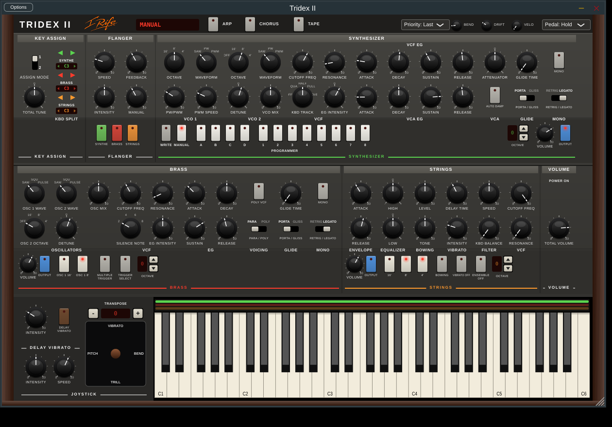

# TRIDEX II — Owner's Manual

TRIDEX II is a performing-keyboard instrument plugin (VST3 on Windows and macOS, plus AU on macOS),
inspired by the Korg Trident Mk II. Like the original, it has three instrument sections:
**SYNTHESIZER**, **BRASS** and **STRINGS**. They share 8 voices and can be split or layered across the keyboard.
TRIDEX II adds per-part arpeggiators and step gates, chorus/ensemble, tape/VHS effects,
mono and legato modes, a true-polyphonic brass mode, and separate outputs for each part.



---

## Contents

1. [Installing](#1-installing)
2. [Colour key](#2-colour-key)
3. [Top bar](#3-top-bar)
4. [KEY ASSIGN](#4-key-assign)
5. [FLANGER](#5-flanger)
6. [SYNTHESIZER](#6-synthesizer)
7. [Programmer](#7-programmer)
8. [BRASS](#8-brass)
9. [STRINGS](#9-strings)
10. [VOLUME](#10-volume)
11. [DELAY VIBRATO, JOYSTICK and TRANSPOSE](#11-delay-vibrato-joystick-and-transpose)
12. [Keyboard and split strip](#12-keyboard-and-split-strip)
13. [ARP page: arpeggiators and step gates](#13-arp-page-arpeggiators-and-step-gates)
14. [CHORUS page](#14-chorus-page)
15. [TAPE page](#15-tape-page)
16. [Signal flow](#16-signal-flow)
17. [Separate outputs](#17-separate-outputs)
18. [MIDI](#18-midi)
19. [Tips](#19-tips)

---

## 1. Installing

**Windows (FL Studio, Ableton, etc.)**
1. Unzip `TridexII-Windows-VST3.zip`.
2. Copy the `Tridex II.vst3` folder to `C:\Program Files\Common Files\VST3\`.
3. Rescan plugins in your DAW. In FL Studio, use *Options → Manage plugins → Find more plugins*.

**macOS (Logic, Ableton, etc.)**
1. Unzip `TridexII-macOS.zip`.
2. Copy `Tridex II.vst3` to `~/Library/Audio/Plug-Ins/VST3/` and `Tridex II.component` to
   `~/Library/Audio/Plug-Ins/Components/`.
3. The plugin is not notarised. If macOS blocks it, follow the steps in the README inside the zip.

To resize the window, drag its bottom-right corner. The panel keeps its proportions.

---

## 2. Colour key

The colours mean the same thing everywhere on the panel and on the pop-up pages:

| Colour | Meaning |
|---|---|
| **Green** | SYNTHESIZER |
| **Red** | BRASS |
| **Orange** | STRINGS |
| **Blue** | Plain on/off switches: part OUTPUT, CHORUS ON, TAPE ON |
| **White** | Programmer (MANUAL, A–D, 1–8) |
| **Cream** | Footage (16' / 8' / 4') |
| **Grey** | Other switches and functions |

The part colours are used on the section titles, the octave displays, the KBD SPLIT controls,
the split strip above the keys, the per-part selectors on the effect pages, and the step gates.

A red LED on a switch means it is on.

---

## 3. Top bar

| Control | What it does |
|---|---|
| **TRIDEX II / logo** | Click the logo to open the About page. Click it again to close. |
| **Display** | Shows `MANUAL` (live panel) or the current program, for example `A1`. |
| **ARP** | Opens or closes the ARP page (arpeggiators and step gates). |
| **CHORUS** | Opens or closes the CHORUS page. |
| **TAPE** | Opens or closes the TAPE page. |
| **Priority** | Note priority for the mono modes: **Last**, **First**, **Low** or **High**. It decides which held note a mono part plays. |
| **BEND** | Pitch-bend range for the joystick and MIDI pitch bend, 0–12 semitones. |
| **DRIFT** | Analog drift. Small random per-voice tuning differences and slow wander, like old oscillators. 0 is perfectly in tune. |
| **VELO** | Velocity sensitivity. The original had none, so 0 plays like the hardware. |
| **Pedal** | Sustain pedal (CC64) behaviour: **Off**; **Damper (S-1)**, a Trident-style release switch that works with AUTO DAMP; or **Hold**, a normal sustain pedal. |

Only one pop-up page (ARP, CHORUS, TAPE or About) is open at a time. The button for the open page is lit.

---

## 4. KEY ASSIGN

| Control | What it does |
|---|---|
| **ASSIGN MODE 1 / 2** | How the 8 voices are handed out. **1**: each new note goes to the next voice in rotation, so release tails ring on. **2**: a note that was played before reuses the same voice, otherwise the lowest free voice is used. |
| **TOTAL TUNE** | Master tuning, ±100 cents. |
| **KBD SPLIT: SYNTHE / BRASS / STRINGS** | Sets where each part plays. **L** plays below that part's split point, **H** plays above it, and **L+H** plays the whole keyboard. |
| **Split point** (small display under each selector) | That part's own split note. Click the arrows to step it, drag or scroll to move it, and double-click the middle to reset to C3. |

Each part has its own split point, so you can layer two parts on one side and keep the third on the other.

---

## 5. FLANGER

A stereo flanger with a selector for each part.

| Control | What it does |
|---|---|
| **SPEED** | LFO rate, 0.05–8 Hz. |
| **FEEDBACK** | Resonance of the flange. Higher values give a stronger metallic tone. |
| **INTENSITY** | Depth of the sweep. |
| **MANUAL** | Centre position of the sweep (delay time). |
| **SYNTHE / BRASS / STRINGS** | Choose which parts go through the flanger. |

---

## 6. SYNTHESIZER

An 8-voice polyphonic synth with two divider-style VCOs, a 4-pole resonant filter and two ADSRs per voice.
The knobs in this section are **programmable**: they are stored by the Programmer (see section 7).

### VCO 1
| Control | What it does |
|---|---|
| **OCTAVE** | 16', 8' or 4'. |
| **WAVEFORM** | **Saw**; **PW**, a fixed pulse width; or **PWM**, a pulse width moved by an LFO. |
| **PW/PWM** | Pulse width in PW mode, or modulation depth in PWM mode. |
| **PWM SPEED** | PWM LFO rate, 0.1–12 Hz. |

### VCO 2
| Control | What it does |
|---|---|
| **OCTAVE** | Off, 16', 8' or 4'. |
| **WAVEFORM** | Saw, PW or PWM. PW and PWM use the PW/PWM settings above. |
| **DETUNE** | ±50 cents against VCO 1. |
| **VCO MIX** | Balance between VCO 1 and VCO 2. |

### VCF
| Control | What it does |
|---|---|
| **CUTOFF FREQ** | Filter cutoff. |
| **RESONANCE** | Filter emphasis. |
| **KBD TRACK** | How far the cutoff follows the keyboard: Off, ¼, ½, Full or Over (more than full). |
| **EG INTENSITY** | How much the VCF EG moves the cutoff. Centre is none; turn left for an inverted envelope. |

### VCF EG and VCA EG
Each has **ATTACK, DECAY, SUSTAIN** and **RELEASE**. Times go up to about 15 s. The VCF EG shapes
the filter, and the VCA EG shapes the volume.

### VCA
| Control | What it does |
|---|---|
| **ATTENUATOR** | Section level trim, ±10 dB. |
| **AUTO DAMP** | When on, a new note cuts the release tails of notes you have already let go. With **Pedal: Damper (S-1)**, holding the pedal lets the tails ring. |

### GLIDE and MONO
| Control | What it does |
|---|---|
| **GLIDE TIME** | Glide between notes, 0–2 s. Glide works in poly and mono modes. |
| **PORTA / GLISS** | **PORTA** glides smoothly. **GLISS** glides in semitone steps. |
| **MONO** | Turns the synth into a true monophonic synth: one voice, no clicks, retuned smoothly from note to note. Which held note sounds is set by **Priority** in the top bar. |
| **RETRIG / LEGATO** | For mono mode. **RETRIG** restarts the envelopes on every note. **LEGATO** only restarts them when you play a note with no other key held, so overlapping notes slide without retriggering. |

### Section switches
| Control | What it does |
|---|---|
| **OCTAVE ▲▼** (green display) | Shifts the whole synth part ±2 octaves. |
| **VOLUME** | Synth part level. |
| **OUTPUT** | Turns the synth part on or off. |

---

## 7. Programmer

There are 32 program slots: banks **A–D** × numbers **1–8**. As on the original, a program stores only the
SYNTHESIZER section's sound settings: VCO 1/2, VCO MIX, VCF, both EGs, ATTENUATOR, AUTO DAMP, GLIDE, PORTA/GLISS, MONO and RETRIG/LEGATO.

| Control | What it does |
|---|---|
| **MANUAL** | Plays the live panel settings. |
| **A B C D** | Choose a bank. While a program is active, a bank press recalls the same number in the new bank. |
| **1 – 8** | Recall that program in the current bank. |
| **WRITE** | Stores the current synth settings. Press **WRITE** (its LED blinks), optionally choose a bank, then press a number **1–8**. Press WRITE again to cancel. |

Programs are saved with your DAW project. They also appear in the host's program list as A1–D8.

---

## 8. BRASS

Brass is modelled on the original's brass board. Every key has its own oscillators, and by default the
whole section shares one filter and one envelope (paraphonic), which gives the classic brass "swell".

### OSCILLATORS
| Control | What it does |
|---|---|
| **OSC 1 WAVE** | Saw, square or pulse. |
| **OSC 1 16' / OSC 1 8'** (cream buttons) | OSC 1 footages. You can turn on either or both. |
| **OSC 2 OCTAVE** | Off, 16', 8' or 4'. |
| **OSC 2 WAVE** | Saw, square or pulse. |
| **DETUNE** | OSC 2 detune, ±50 cents. |
| **OSC MIX** | Balance between OSC 1 and OSC 2. |

### VCF and EG
| Control | What it does |
|---|---|
| **CUTOFF FREQ / RESONANCE** | Brass filter. |
| **EG INTENSITY** | How much the EG opens the filter. |
| **ATTACK / DECAY / SUSTAIN / RELEASE** | Brass envelope, for both the filter and the volume. |
| **POLY VCF** | Gives each note its own filter instead of one shared filter. |
| **SILENCE NOTE (2/4/6/8)** | Used with **TRIGGER SELECT**. The envelope only starts once this many keys are held. |
| **TRIGGER SELECT** | Turns on the SILENCE NOTE threshold. |
| **MULTIPLE TRIGGER** | Restarts the shared envelope on every new key, instead of only on the first key of a phrase. |

### VOICING, GLIDE and MONO
| Control | What it does |
|---|---|
| **PARA / POLY** | **PARA** is the original paraphonic brass, with one filter and envelope for the section. **POLY** is true polyphonic brass: each note has its own filter and envelope, like a normal poly synth. |
| **GLIDE TIME** and **PORTA / GLISS** | Same as on the synth. |
| **MONO** and **RETRIG / LEGATO** | True monophonic brass, same behaviour as on the synth. Uses the top-bar Priority. |

### Section switches
**VOLUME**, **OUTPUT** (on/off) and **OCTAVE ▲▼** (red display, ±2 octaves).

---

## 9. STRINGS

A divide-down string machine with ensemble, bowing, vibrato and EQ.

| Control | What it does |
|---|---|
| **ATTACK / RELEASE** (ENVELOPE) | String fade-in and fade-out. |
| **HIGH / LOW** (EQUALIZER) | Treble and bass shelving EQ. |
| **LEVEL / TONE** (BOWING) | Level and brightness of the bow "scrape" at the start of each note. Turned on by the **BOWING** button. |
| **DELAY TIME / INTENSITY / SPEED** (VIBRATO) | Vibrato that fades in after the delay time. **VIBRATO OFF** turns it off. |
| **KBD BALANCE** | Tilts the level between the low and high ends of the keyboard. |
| **CUTOFF FREQ / RESONANCE** (VCF) | Strings tone filter. |
| **16' / 8' / 4'** (cream) | String footages. Combine them freely. |
| **ENSEMBLE OFF** | Turns off the built-in string ensemble (the lush chorus) for a drier, thinner sound. |
| **VOLUME / OUTPUT / OCTAVE ▲▼** | Part level, part on/off, and ±2 octaves (orange display). |

---

## 10. VOLUME

**TOTAL VOLUME** is the master level. It sets the Main output and the three separate part outputs.

---

## 11. DELAY VIBRATO, JOYSTICK and TRANSPOSE

| Control | What it does |
|---|---|
| **DELAY VIBRATO** (button) + **INTENSITY** | Vibrato that fades in a moment after each note, for expressive leads. |
| **JOYSTICK** | Drag the ball. **Left/right** is pitch bend (range set by BEND in the top bar). **Up** adds vibrato and **down** adds trill. It springs back to the centre when released. |
| **INTENSITY / SPEED** (under the joystick) | Depth and rate of the joystick's vibrato and trill. |
| **TRANSPOSE** | Transposes the whole instrument ±12 semitones. Use **− / +**, and double-click the value to reset. |

---

## 12. Keyboard and split strip

The on-screen keyboard (C1–C6) plays the instrument with the mouse.

The **strip above the keys** shows where each part plays:
- a coloured bar for each part (green synth, red brass, orange strings) shows its range,
- a marker with a small triangle shows each split point,
- a dim bar means that part's OUTPUT is off.

---

## 13. ARP page: arpeggiators and step gates

Click **ARP** in the top bar. Each part has its own row.

### Arpeggiator
| Control | What it does |
|---|---|
| **ARP ON** | Arpeggiates the notes you hold for this part. |
| **MODE** | Up, Down, Up/Down, Random or Played (the order you pressed the keys). |
| **RATE** | 1/4, 1/8, 1/8T, 1/16, 1/16T or 1/32. |
| **OCTAVES** | Spreads the pattern over 1–4 octaves. |
| **NOTE LEN** | Length of each arp note, from short staccato to full length. |
| **SYNC** | Locks the arp to your DAW's tempo and position. When SYNC is off, the **TEMPO** knob (top right) sets the speed. |

### Step gate
A rhythmic gate (a "trance gate") on the part's audio.

| Control | What it does |
|---|---|
| **STEP GATE** | Turns the gate on for this part. |
| **L / R lanes** | 8 steps for the left channel and 8 for the right. Click a step to toggle it, or drag across steps to paint. Different L and R patterns make the sound bounce between speakers. The current step is outlined while playing. |
| **RATE / SYNC** | Step length, and lock to the DAW tempo (or the TEMPO knob when SYNC is off). |

Arp and step gate can be used together or separately.

---

## 14. CHORUS page

Click **CHORUS** in the top bar. This is a stereo chorus and ensemble in the spirit of classic
dimension-style units.

| Control | What it does |
|---|---|
| **CHORUS ON** | Turns the chorus on. |
| **SYNTHE / BRASS / STRINGS** | Choose which parts go through it, like on the flanger. |
| **MODE** | **Chorus I**: gentle. **Chorus II**: deeper. **Ensemble**: a rich multi-voice string-machine ensemble. **Space**: dimension-style modes. |
| **SPACE 1–4** | Intensity steps for Space mode, from subtle (1) to wide (4). |
| **RATE / DEPTH** | Modulation speed and amount. |
| **WIDTH** | Stereo spread. |
| **TONE** | Brightness of the chorused signal. |
| **MIX** | Dry/wet balance. |

The chorus runs before the flanger.

---

## 15. TAPE page

Click **TAPE** in the top bar. This is a tape and VHS processor, from subtle tape colour to very wobbly worn VHS.
It sits at the end of each part's effect chain.

| Control | What it does |
|---|---|
| **TAPE ON** | Turns the tape effect on. |
| **TAPE TYPE** | **Studio**: clean reel, little wobble. **Cassette**: more flutter, softer top end, a little hiss. **VHS**: strong wow, darker, noisier. **Worn VHS**: very wavy and unstable, with dropouts. |
| **WOW** | Slow pitch sway. |
| **FLUTTER** | Fast pitch shimmer. |
| **SPEED** | How fast the tape wobbles (0.25×–2×). |
| **DRIFT** | Random, unsteady wobble on top of the regular wow. |
| **AGE** | Darker, more worn tape (high-frequency loss). |
| **HISS** | Tape noise. |
| **MIX** | Dry/wet balance. |

### Saturation per part
Each part has a **select switch** (green, red or orange) to send it through the tape, and its own **DRIVE**
knob for tape saturation. For example, you can drive the brass hard while the strings stay clean.

For the really wavy sound, choose **Worn VHS** and turn **WOW** and **DRIFT** up. The pitch then
sways by about a semitone.

---

## 16. Signal flow

```
                 ┌─ SYNTHESIZER ─ step gate ─ CHORUS ─ FLANGER ─ TAPE ─┐
keys ─ arps ─────┼─ BRASS ─────── step gate ─ CHORUS ─ FLANGER ─ TAPE ─┼─ TOTAL VOLUME ─ outputs
                 └─ STRINGS ───── step gate ─ CHORUS ─ FLANGER ─ TAPE ─┘
                                (each effect only applies to the parts selected on it)
```

The three parts share the same 8 voices, as on the original. Each part is also sent to its own output (see section 17).

---

## 17. Separate outputs

TRIDEX II has four stereo outputs:

| Output | Contents |
|---|---|
| **Main** | The full mix |
| **Synthe** | Synthesizer part only, with its effects |
| **Brass** | Brass part only, with its effects |
| **Strings** | Strings part only, with its effects |

**FL Studio:** in the plugin wrapper, open the settings (gear icon), go to *Processing*, and turn on
the additional outputs. Then route each output to its own mixer track.
In other DAWs, enable the plugin's extra outputs in the track or instrument output settings.

---

## 18. MIDI

| MIDI | Function |
|---|---|
| Notes | Play the instrument. Velocity only matters if **VELO** is above 0. |
| Pitch bend | Joystick left/right |
| CC1 (mod wheel) | Joystick up (vibrato) |
| CC2 | Joystick down (trill) |
| CC64 (sustain) | Pedal, as set by **Pedal** in the top bar |

All knobs and switches can be automated from your DAW.

---

## 19. Tips

- **Classic Trident layer:** strings on L+H, brass on H with a little chorus, and the synth on L as a mono bass with LEGATO and a short glide.
- **Split points:** give every part its own split to make three-zone setups.
- **Stereo rhythm:** a step gate with opposite L and R patterns on the strings makes a bouncing pad.
- **Lo-fi keys:** TAPE on, type VHS, AGE up, HISS a little, DRIVE up on the synth only.
- **Bigger brass:** switch to POLY, add OSC 2 an octave up with a little detune, and use Chorus II.

---

*TRIDEX II by I Rife — [instagram.com/irife](https://www.instagram.com/irife).
Korg and Trident are trademarks of Korg Inc. This independent project is not affiliated with or endorsed by Korg.*
