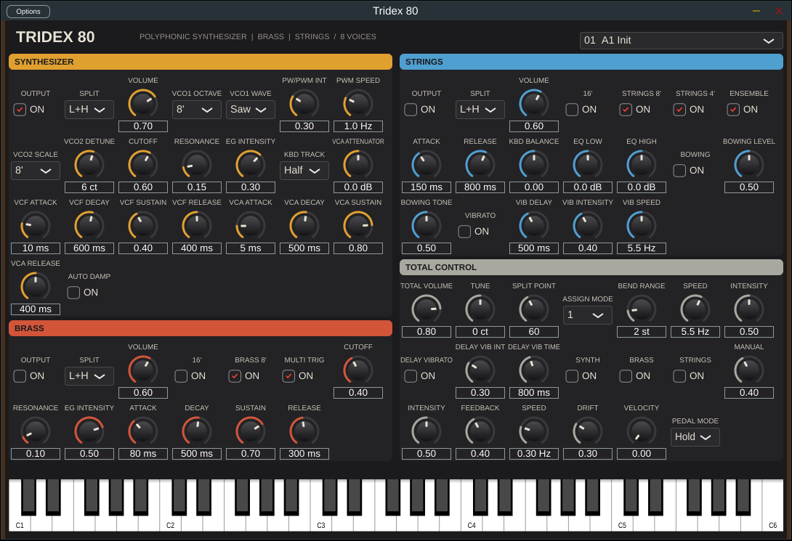

# Tridex 80

A VST3 / Standalone instrument modelling the **Korg Trident Mk II** (1980–82),
built from its service manual (block diagram + KLM board schematics). JUCE 8, C++17.



## Build

```bash
cmake -B build -G Ninja -DCMAKE_BUILD_TYPE=Release   # uses ../JUCE if present, else fetches JUCE 8.0.4
cmake --build build
```

Artefacts are written to `build/Tridex80_artefacts/Release/{VST3,Standalone}`.
To run the headless DSP test (renders WAVs and checks for NaN/silence), use:
`g++ -std=c++17 -O2 -ISource tests/render_test.cpp -o rt && ./rt /tmp`

## How the circuit maps to code

| Hardware (service manual) | Code |
|---|---|
| KLM-377 key assigner, 8 voices shared by all sections, Mode 1/2, split L / L+H / H per section | `Engine::allocate`, `inZone` |
| KLM-379 VCO1/VCO2: saw core + 4013 flip-flop dividers. 16'/8' saws are built by summing the core saw with divided squares, so all footages are phase-locked | `DividerVco` (exact identity, plus per-voice summing-resistor tolerance) |
| VCO1 saw / PW / PWM with a shared PWM LFO; VCO2 Off/16'/8'/4' saw only, detune | `Engine::render` synth block |
| KLM-378 per-voice SSM2044 4-pole VCF, SSM2056 ADSRs, KBD track Off/¼/½/Full/Over, VCA attenuator ±10 dB, Auto Damp | `Ladder` (ZDF, saturating), `Adsr` (RC curves) |
| KLM-403 brass: per-voice MPX-EG gate, then **one** VCF/VCA and one EG (paraphonic), 16'+8', multiple trigger | `brassVcf`, `brassEnv` |
| KLM-384/404 strings: KBD balance, per-voice AR VCA, vibrato, ensemble, bowing, EQ | strings chain in `render` |
| KLM-401 MG: joystick X = bend, Y+ = vibrato, Y− = trill; delay vibrato; flanger with per-section select | MG block plus `Flanger` |

MIDI: pitch bend = joystick X, CC1 = joystick Y+ (vibrato), CC2 = joystick Y− (trill),
CC64 = foot switch (hold, or Trident-style release switch for Auto Damp).

## Not yet verified against hardware (best interpretations)

- **Auto Damp:** modelled as "release tails cut unless the release foot switch is down" (from the RELEASE/AUTO DAMP NOR gating on KLM-378).
- **Assign Mode 1/2:** modelled as rotating vs. same-voice/lowest-free assignment.
- **Brass "Trigger Select" and "Silence Note (2,4,6,8)":** not implemented yet; their function is unclear from the schematics alone.
- **Bowing (Level, Tone):** modelled as a band-passed, per-note attack transient.
- **Compressor/expander:** omitted, since it is a BBD noise-reduction compander and is ideally transparent.
- **Component values** for the divider summing weights, EG curves and filter scaling are approximations; calibration against a real unit or recordings is still to do.
- Separate per-section outputs (the hardware has them) are not yet exposed as plugin buses.

Trident and Korg are trademarks of Korg Inc. This project is not affiliated with or endorsed by Korg.
